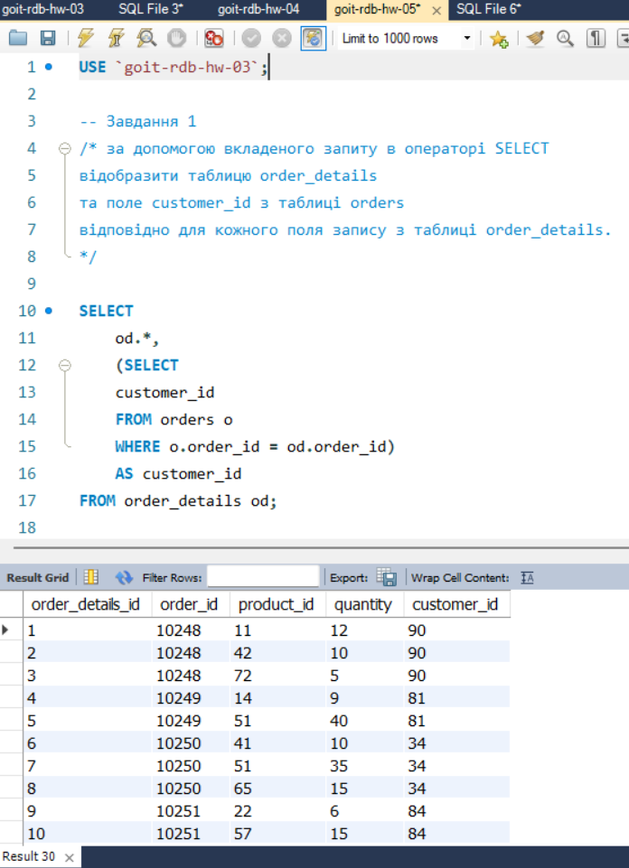
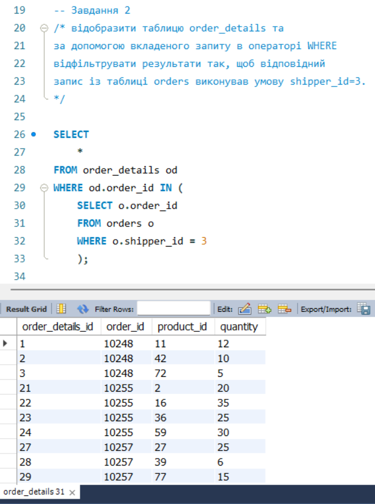
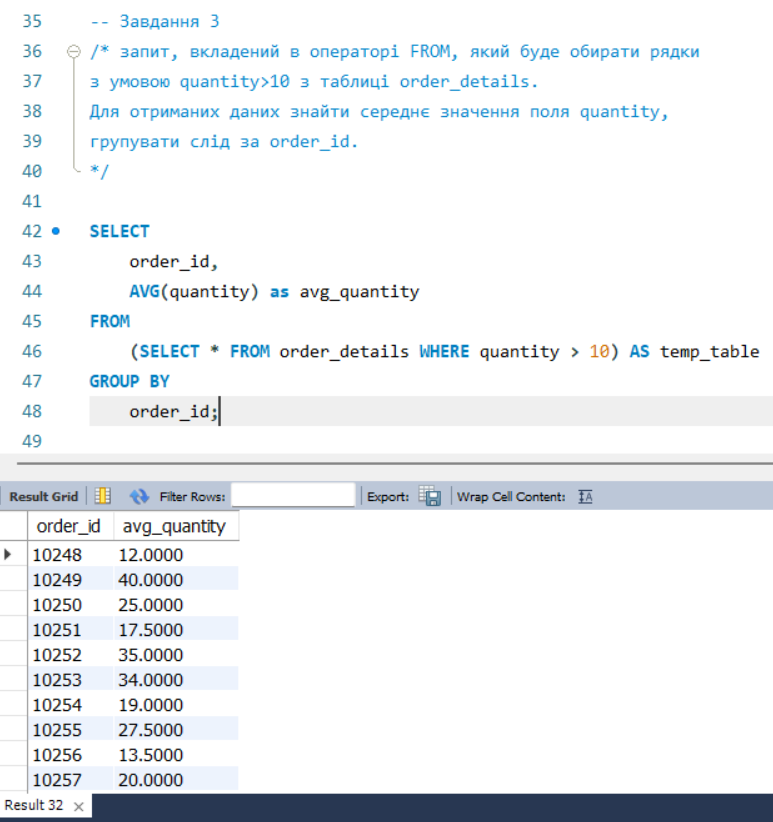
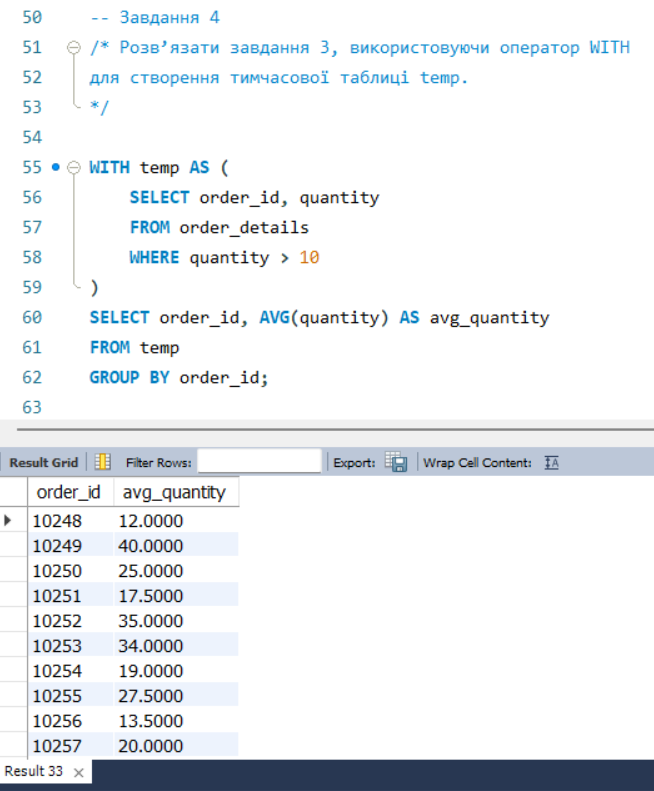
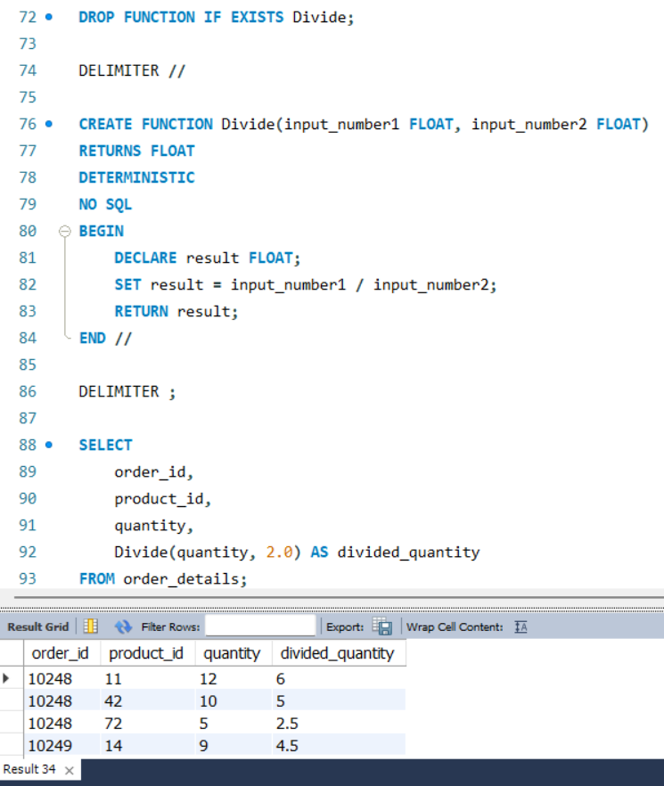

# goit-rdb-hw-05: Nested SQL queries. Code reuse

Цей репозиторій містить практичні завдання з використання вкладених SQL-запитів (підзапити в `SELECT`, `WHERE`, `FROM`), узагальнених табличних виразів (`CTE` / оператор `WITH`) та створення користувацьких функцій (`UDF`) у середовищі MySQL.

---

## Структура репозиторію

* `goit-rdb-hw-05.sql` — повний скрипт з усіма SQL-командами до завдань 1–5.
* `/screenshots/` — каталог зі скриншотами виконаних запитів та результатів:
  * `p1_select_subquery.png` — результат виконання завдання 1.
  * `p2_where_subquery.png` — результат виконання завдання 2.
  * `p3_from_subquery.png` — результат виконання завдання 3.
  * `p4_cte_with.png` — результат виконання завдання 4.
  * `p5_stored_function.png` — створення та виклик функції із завдання 5.

---

## Опис виконаних завдань

### Завдання 1. Вкладений запит у блоці SELECT
Реалізовано скалярний корельований підзапит, який для кожного рядка з таблиці `order_details` повертає відповідне значення `customer_id` із таблиці `orders`.

```sql
SELECT 
    od.*,
    (
        SELECT o.customer_id 
        FROM orders AS o 
        WHERE o.order_id = od.order_id
    ) AS customer_id
FROM order_details AS od;
```


### Завдання 2. Вкладений запит у блоці WHERE
Виконано фільтрацію замовлень за допомогою предикату IN, щоб відібрати записи деталей замовлень, для яких служба доставки має ідентифікатор shipper_id = 3.

```sql
SELECT od.*
FROM order_details AS od
WHERE od.order_id IN (
    SELECT o.order_id 
    FROM orders AS o 
    WHERE o.shipper_id = 3
);
```



### Завдання 3. Вкладений запит у блоці FROM (Derived Table)
Сформовано проміжну віртуальну таблицю з рядками, де quantity > 10. На базі отриманих даних пораховано середнє значення поля quantity з групуванням за order_id.

```sql
SELECT 
    temp.order_id,
    AVG(temp.quantity) AS avg_quantity
FROM (
    SELECT order_id, quantity 
    FROM order_details 
    WHERE quantity > 10
) AS temp
GROUP BY temp.order_id;
```



### Завдання 4. Використання оператора WITH (CTE)
Аналогічно завданню 3 розраховано середню кількість товару для позицій із quantity > 10, проте тимчасову таблицю винесено в блок WITH для підвищення читабельності коду.

```sql
WITH temp AS (
    SELECT order_id, quantity 
    FROM order_details 
    WHERE quantity > 10
)
SELECT 
    order_id, 
    AVG(quantity) AS avg_quantity
FROM temp
GROUP BY order_id;
```



### Завдання 5. Створення функції користувача (User-Defined Function)
Створено детерміновану функцію Divide, яка приймає два параметри типу FLOAT, виконує операцію ділення та повертає результат типу FLOAT. Функцію застосовано до поля quantity таблиці order_details (із тестовим дільником 2.0).

```sql
DROP FUNCTION IF EXISTS Divide;

DELIMITER //

CREATE FUNCTION Divide(input_number1 FLOAT, input_number2 FLOAT)
RETURNS FLOAT
DETERMINISTIC 
NO SQL
BEGIN
    DECLARE result FLOAT;
    SET result = input_number1 / input_number2;
    RETURN result;
END //

DELIMITER ;

SELECT 
    order_id,
    product_id,
    quantity,
    Divide(quantity, 2.0) AS divided_quantity
FROM order_details;
```


